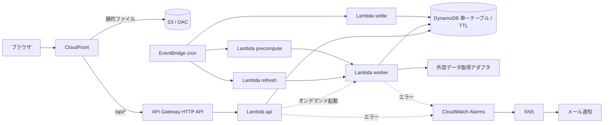

# アーキテクチャ

## 設計判断

| 判断 | 理由 | 代わりに考えた案 |
|---|---|---|
| 計算は事前に実行して保存し、APIは読むだけ | 遅いのは計算でなくデータ取得（10〜30秒）。利用者数と外部アクセス数を切り離せる | 毎回計算（遅い・外部への負荷が利用者に比例） |
| workerとapiを別Lambdaに分離 | 重い処理（1024MB/180秒）と軽い応答（256MB/29秒）で必要な資源が違う | 1つにまとめる（API用に過大なメモリを払う） |
| DynamoDB単一テーブル + TTL | アクセスパターンが固定（キー検索のみ）。古い予想は30日で自動削除 | RDS（常時課金・運用負荷） |
| 画面HTMLを圧縮（zlib+base64）して保存 | 1アイテム400KB上限を避けるため。券種ごとに別アイテム | S3に保存（読み出しが増える） |
| CloudFrontで同一ドメインに集約 | CORS不要、S3は非公開（OAC）、APIもHTTPSのみ | S3を公開（セキュリティ上避ける） |
| arm64（Graviton） | 同じ性能で安い。wheelは`--platform manylinux2014_aarch64`で取得するのでDocker不要 | x86_64 |
| アクセスコード + スロットリング | 限定公開で乱用を防ぐ最小構成。比較は`hmac.compare_digest` | Cognito（個人用途には過剰） |

## 制約と対処

| 制約 | 対処 |
|---|---|
| DynamoDB 1アイテム400KB | 圧縮、券種ごとに分割 |
| Lambda 解凍後250MB | numpy/pandas以外の依存を最小化、不要ファイルを除去 |
| API Gateway 29秒 | 重い処理はworkerへ非同期。画面はポーリング |

## 費用の目安
常時課金されるリソースがなく（DynamoDBオンデマンド、Lambda、CloudFront、S3）、個人利用では月数ドル以内です。
AWS Budgetsで月5ドルの80%を超えると通知します。
